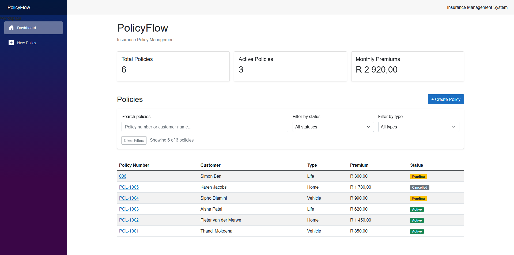

# PolicyFlow

A small insurance policy management app built with **Blazor Server**, **.NET 8**, **Entity Framework Core** and **SQL Server**.

Create, search, filter, edit and delete insurance policies, with a dashboard showing totals and monthly premiums at a glance.



## Features

- Dashboard with total policies, active policies and monthly premium income (active policies only)
- Live search by policy number or customer name, plus status and policy-type filters
- Create, view, edit and delete policies (with a delete confirmation)
- Policy numbers are unique, case-insensitively, enforced in the service **and** by a unique database index
- Form validation with clear error messages
- Sample data seeded automatically on first run in development

## Tech stack

| Area | Choice |
| --- | --- |
| UI | Blazor Server (interactive server rendering), Bootstrap 5 |
| Backend | ASP.NET Core, .NET 8 |
| Data | EF Core 8 with migrations, SQL Server |
| Tests | xUnit with the EF Core in-memory provider |
| CI | GitHub Actions (build and test on every push and pull request) |

## Getting started

### Option 1: Docker (nothing else to install)

```bash
docker compose up --build
```

Open <http://localhost:8080>. This starts SQL Server and the app, applies migrations and seeds sample data.

### Option 2: Run locally

You need the [.NET 8 SDK](https://dotnet.microsoft.com/download/dotnet/8.0) and SQL Server (LocalDB comes with Visual Studio on Windows).

```bash
git clone <your-repo-url>
cd PolicyFlow
dotnet run --project PolicyFlow
```

In Development the app creates the database, applies migrations and inserts sample data on startup, so no manual `dotnet ef` step is needed.

The default connection string in `PolicyFlow/appsettings.json` targets LocalDB. To use a different SQL Server without editing tracked files, use [user secrets](https://learn.microsoft.com/aspnet/core/security/app-secrets):

```bash
cd PolicyFlow
dotnet user-secrets set "ConnectionStrings:DefaultConnection" "Server=YOUR_SERVER;Database=PolicyFlowDb;Trusted_Connection=True;TrustServerCertificate=True"
```

To apply migrations manually instead (for example in production, where the startup option is off):

```bash
dotnet tool install --global dotnet-ef
dotnet ef database update --project PolicyFlow
```

## Running the tests

```bash
dotnet test
```

## Project structure

```
PolicyFlow/
├── PolicyFlow/                 Web app
│   ├── Components/
│   │   ├── Layout/             Main layout and sidebar navigation
│   │   ├── Pages/              Dashboard, create, edit and details pages
│   │   └── Shared/             Reusable components (status badge)
│   ├── Data/                   DbContext and sample-data seeder
│   ├── Migrations/             EF Core migrations
│   ├── Models/                 InsurancePolicy and allowed status/type values
│   └── Services/               PolicyService (all business rules)
└── PolicyFlow.Tests/           xUnit tests for PolicyService and the seeder
```

## Design notes

- **`PolicyService` owns the rules.** Trimming, allowed policy types and statuses, and duplicate checks all live in one place. It returns a `PolicyResult` (`Success`, `DuplicatePolicyNumber`, `NotFound`, ...) rather than mixing booleans and exceptions, and the pages turn that into a user-friendly message.
- **`IDbContextFactory` instead of a shared DbContext.** Blazor Server circuits are long-lived, so a scoped context would keep growing and hold stale tracked entities. The service creates a short-lived context per operation and reads with `AsNoTracking`.
- **Duplicates are checked twice.** The service checks first for a friendly error, and the unique index guards against two simultaneous requests slipping through; the service handles that case too.
- **New policies always start as Pending.** The status can only change through the edit form.

## Possible next steps

- Pagination or server-side filtering for large datasets
- Authentication and roles (agent vs. admin)
- Policy start/end dates and renewal reminders
- Audit log of status changes

## Notes

PolicyFlow is a portfolio project. All seeded names and policy data are fictional.
